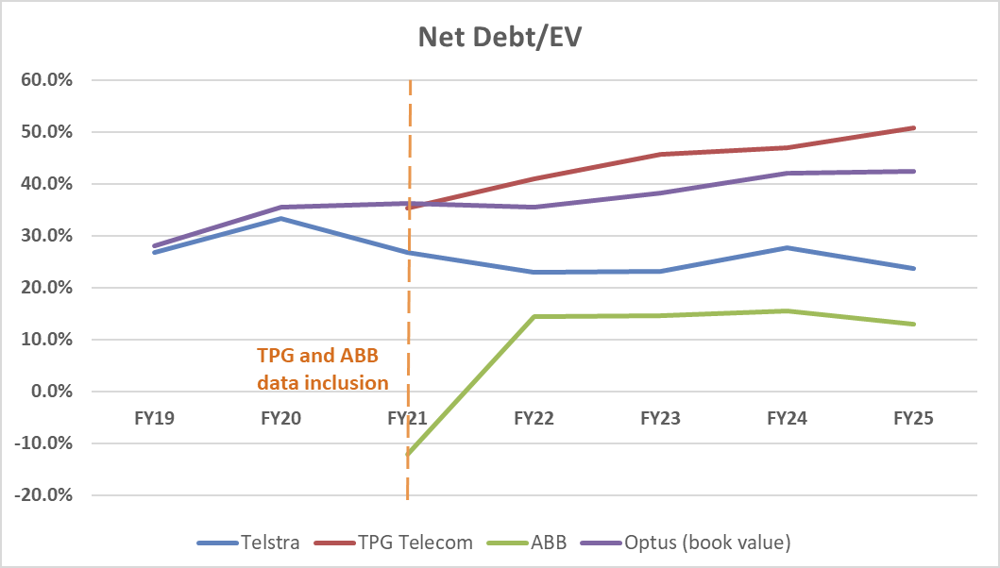

# Capital Structure Analysis: Telstra and Telecom Peers, FY19 to FY25

Corporate Finance II (FINC2012), University of Sydney, 2026. Group project.

**[Project page](https://evelynlieu1.github.io/telstra-capital-structure/)**

Contributed to a five-person group report advising a hypothetical Telstra CFO on leverage. This page shows Part B, the comparison with peers.

- Peers TPG, Optus and Aussie Broadband were chosen on revenue mix. Periods that would distort the comparison were excluded, with the reasons stated.
- I worked on the Optus estimate. Optus is not separately listed, so it uses book net debt reported by Singtel.
- By FY25 Telstra had the lowest leverage of the three network operators. Its net debt to EBITDA stayed between about 1.5x and 1.9x from FY19 to FY25.

*Figure 7 from the report: Telstra's net debt to EV stayed between about 23% and 33%, below Optus and TPG in every year shown.*

Other sections of the report are not included.
